# Ymir brand

Ymir is a self-hosted cloud of LLM models across your own devices, named after the primordial frost giant of Norse myth. The mark is a frost giant's head built from a mesh of connected nodes with two angular eyes.

## Palette

| Colour | Hex | Use |
|---|---|---|
| Glacier | `#7FD4F5` | Mark, links, primary accent |
| Frost | `#E8F6FC` | Text on dark, light backgrounds |
| Deep Fjord | `#0E3B5C` | Mark on light backgrounds, deep surfaces |
| Basalt | `#1A1D23` | Dark background |
| Ember | `#FF7A45` | Accent only: the eyes, one highlight per screen |

## Theme tokens

Dark is the default theme.

| Dark token | Value |
|---|---|
| `background` | `#1A1D23 (Basalt)` |
| `surface` | `#20242C` |
| `border` | `#2E3440` |
| `text` | `#E8F6FC (Frost)` |
| `text-muted` | `#9FB3BE` |
| `accent / link` | `#7FD4F5 (Glacier)` |
| `highlight` | `#FF7A45 (Ember)` |

| Light token | Value |
|---|---|
| `background` | `#E8F6FC (Frost)` |
| `surface` | `#FFFFFF` |
| `border` | `#C5DCE8` |
| `text` | `#1A1D23 (Basalt)` |
| `accent / link` | `#0E3B5C (Deep Fjord)` |
| `highlight` | `#FF7A45 (Ember)` |

The Bragi app and site share Glacier (`#7FD4F5`) as the link colour.

## Typography

| Role | Font | License |
|---|---|---|
| Wordmark and headings | Space Grotesk (Bold 700, +6% tracking) | SIL Open Font License 1.1 |
| Body and UI | Inter | SIL Open Font License 1.1 |

Both are open-licensed and free to embed. The wordmark is converted to outlines in `brand/svg/`, so the SVGs
need no font installed. The sites self-host Inter (`site/web/fonts/LICENSE-Inter.txt`).

## Files (`brand/`)

- `svg/`: `ymir-mark`, `ymir-wordmark`, `ymir-lockup` (horizontal), each in dark (default), `-light`, `-black` and
  `-white` variants; `ymir-icon` (rounded app icon), `ymir-icon-square`, `ymir-android-foreground`,
  `-android-background`, `-android-monochrome`, and `ymir-social`. All hand-drawn, no raster, no filters.
- `png/hicolor/<size>/apps/ymir.png` (16 to 512) and `scalable/apps/ymir.svg` for Linux desktop icons.
- `png/android/`: adaptive icon (foreground, background, monochrome) at every density, legacy and round icons,
  `play-store-512.png`.
- `png/ios/AppIcon.appiconset` and `png/macos/AppIcon.appiconset` (+ `ymir.icns`), `png/windows/ymir.ico`.
- `png/favicon/`: `favicon.svg`, `favicon.ico`, 16/32 PNG, `apple-touch-icon.png`, 192 and 512.
- `brand-sheet.png`: the overview sheet. `licenses/`: the font licenses (OFL).
- `png/social/ymir-social-1200x630.png`.

## Usage

- Keep clear space around the mark of at least the width of one node (about 1/12 of the mark's width).
- Minimum size: the mark 16 px high (use `favicon.svg`, which has heavier strokes); the lockup 120 px wide.
- Use the glow version only on dark backgrounds. On light backgrounds use `-light`; for one-colour print use `-black` or `-white`.
- Ember is only for the eyes and a single highlight; never for body text or large fills.
- Do not stretch, rotate, recolour outside the palette or outline the mark.
- Ymir and Bragi share Glacier; a Bragi link on a Ymir page uses the Bragi mark in Mead Gold.
